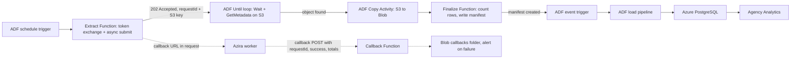

# Advance DSP to PostgreSQL: Pipeline Spec

Oct 22, 2026 (updated Oct 26, 2026) · @Marc

## Purpose and scope

This spec defines an Azure pipeline that moves Advance DSP reporting into an Azure PostgreSQL database so Agency Analytics can replace Tapclicks for Azira campaigns by the end of October.

- **In scope (v1):** the async demand report (`POST /v1/reports/demand`), at daily grain by advertiser and campaign, refreshed on a rolling 5-day window (pending the vendor's verification of how far back numbers change). Grain and metrics follow the current Tapclicks reports, as confirmed by the reporting team. Results are delivered to a customer-owned S3 bucket and bridged into Blob by ADF (see [Architecture and flow](#architecture-and-flow)); the vendor's sync endpoint is not available on this credential.
- **Out of scope (v1):** historical backfill, new metrics or report designs, and any report whose field group is not already enabled for this credential.
- **Consumer:** Agency Analytics connects to the database with a read-only login and queries one view.
- **Status:** in build. Azure PostgreSQL and the Azure Function approach are decided, and all approvals, access and expense are in place; what remains is build and testing (see [Decisions](#decisions-and-resolved-items) and [Project phases](#project-phases-2-and-3)). The PostgreSQL server was deployed on 2026-10-26. The design targets the vendor's real OAuth2/async Reporting API (the Swagger file originally supplied with this project describes an unrelated, confirmed-obsolete system — see [Sources](#sources)). The project brief covers scope, decisions and owners. This spec covers the design.

## Architecture and flow

ADF schedules an extract Function that exchanges OAuth2 credentials for a bearer token and submits one async report request to Azira's Reporting API. Azira's own worker process writes the result to a customer-owned S3 bucket on its own schedule; ADF polls for that file, copies it into Blob, and a finalize Function writes a manifest once it has counted the rows. An event-triggered ADF pipeline then loads it into Azure PostgreSQL once the manifest lands. Azira's completion callback, a required parameter on every async request, lands on a small callback Function that stores the payload in Blob. It is a diagnostic and validation signal, not the load trigger, so a missed callback cannot block the load.



The extract Function is the only code that talks to the vendor's API. ADF's own native Amazon S3 linked service — not a Function — reads the delivered file. After ADF has copied the file into Blob, a separate lightweight finalize Function counts the rows and writes the manifest. Loading is ADF activities plus one stored procedure in PostgreSQL.

Design rules:

- **Two stages, Blob in between.** A failed load can be replayed from Blob without calling the API again. Manifest written last. The load never runs on a partial extract.
- **Idempotent load.** Each load replaces its whole date window in one transaction, so retries and duplicate events are safe.
- **Thin code, SQL for shaping.** The Functions only submit, count and record callbacks. Renaming, casting and shaping live in the ADF column mapping, a stored procedure and a view.
- **One small public endpoint.** Delivery is pulled (ADF polls S3) rather than pushed, so the load never depends on a webhook. The only inbound endpoint is the callback receiver, which Azira's API requires on every async request. It records the payload and treats it as untrusted.

## Blob layout

Each extract run writes two files under one path, and the manifest is always written last.

| File | Path | Purpose |
| --- | --- | --- |
| Data | `dsp-raw/advance-dsp/{report_id}/window={start}_{end}/run={run_id}/data.csv.gz` | The gzip CSV file Azira delivered to S3, copied unchanged (header row, one record per line) |
| Manifest | `dsp-raw/advance-dsp/{report_id}/window={start}_{end}/run={run_id}/manifest.json` | Run metadata and validation results. Its creation triggers the load |

The container name `dsp-raw` is a placeholder. The data file is copied from S3 as a binary copy, so the original gzip is preserved, and the event trigger filters on `manifest.json` only, which is written after the copy completes.

Manifest fields:

| Field | Meaning |
| --- | --- |
| `run_id` | ADF pipeline run ID passed by the caller |
| `report_id` | Report definition used (for example `demand_daily`) |
| `window_start`, `window_end`, `tz` | Date window and timezone of the query |
| `request_body` | Exact async request body sent, with no secrets in it |
| `request_id` | `requestId` returned by the vendor's 202 Accepted response |
| `record_count` | Rows written to the data file, counted by the finalize step |
| `computed_totals` | Totals summed from the records written |
| `status` | `ok` or `empty` (failed runs write no manifest) |
| `data_file`, `data_sha256` | Data file path and checksum |
| `extracted_at`, `function_version` | Timestamp and code version |

No field here cross-checks `record_count`/`computed_totals` against a vendor-reported total, unlike the old sync design's `api_total_records`/`api_aggregate_totals`. The async submission response carries only `requestId`; the vendor's `totalRecords` and `aggregateTotals` arrive only in the completion callback, which the callback receiver stores under `callbacks/{requestId}.json` in Blob (a later check compares them with `record_count` and `computed_totals`, and the load does not wait for it). A live test on 2026-10-21 showed what that cross-check would look like: the 22 rows and the impressions total matched the callback exactly, while revenue differed by 0.02 (probably because the vendor sums unrounded values). So counts are compared exactly and revenue within a tolerance (see [Testing](#testing-and-parity-validation)).

Retention: a lifecycle rule that moves files to cool storage after 30 days and deletes them after 180 days is the starting point, set during build.

## Extract Function

The extract Function exchanges OAuth2 credentials for a bearer token and submits one async report request to Azira's Reporting API. It does not page, sign requests, or wait for the result — Azira's worker process delivers the file to S3 on its own schedule, and ADF polls for it (see [ADF pipelines](#adf-pipelines)).

**Contract.** HTTP trigger, called by the ADF Azure Function activity.

```json
{ "report_id": "demand_daily", "window_start": "2026-10-17", "window_end": "2026-10-21", "run_id": "<ADF pipeline run id>" }
```

On success it returns 200 with the vendor's `requestId` and the exact S3 key it told the vendor to deliver to, so ADF knows what to poll for. On any failure it returns a non-2xx status and submits nothing.

**Steps**

- Load the report definition for `report_id`: field group, dimensions, aggregates, filters, timezone and grain key columns (kept in config, so adding a report needs no code change).
- Read `client_id` and `client_secret` from Key Vault using the Function's managed identity.
- Exchange them for a bearer token: `POST {token_url}` with HTTP Basic auth and `grant_type=client_credentials&scope=rtb-client-api/access`. Cache the token in memory for its lifetime (15 minutes per the vendor's example) rather than requesting one per call.
- Build the async request body: `dimensions`, `aggregates`, `filters` (an empty array means no filter, confirmed by testing), `orderBys`, `date{start,end,tz}`, and `output{format:"csv", compression:"gzip", s3:{bucket, key}}`, where `key` is derived deterministically from `report_id`, the window and `run_id` so the Function and the ADF polling step agree on it without a round trip. Give every column an alias so the CSV headers are the snake_case column names, and request raw numbers by leaving out the `format` and `maximumFractionDigits` options on aggregates. Include the required `callback` and `label`.
- `POST {base_url}/reports/demand` with the bearer token. A 202 response carries `requestId` and `status: "queued"`; return both, plus the S3 key, to the caller.
- Fail immediately on any other status and log the response body, including the vendor's ACL error codes (`error.report.asyncNotAllowed`, `error.field.restricted`) if present: those mean the credential's access needs to change, not that the request was malformed.

**Time budget.** This call is lightweight — a token exchange and a single POST — so it finishes in well under the ADF Function activity's 230-second limit regardless of window size. The slow part of this stage is the vendor's own async turnaround, which the ADF Until loop (not the Function) waits out.

**Empty results.** The Function has no way to know ahead of time whether the query will return zero rows — that's discovered by the finalize step after the file is delivered (see [ADF pipelines](#adf-pipelines)). It is not treated as an error there either.

**What it does not do.** No signing, paging, or waiting for the result. No renaming, type casting or aggregation — the data file holds the API records as returned once ADF has copied them from S3.

## Load pipeline

An event-triggered ADF pipeline reads one extract run from Blob, copies it into a staging table, and calls one stored procedure that replaces that run's date window in the reporting table.

**Trigger.** ADF storage event trigger on the `dsp-raw` container: BlobCreated, blob path ends with `manifest.json`, empty blobs ignored. The trigger body supplies the folder path and file name of the manifest.

**Steps**

- A Lookup activity reads `manifest.json` (first row only).
- If `status` is `empty` and `allow_empty_replace` is off, log a warning and stop successfully without touching existing rows.
- A Copy activity reads `data.csv.gz` from the same folder (DelimitedText dataset, compression gzip, first row as header) into `stg.demand_daily` with the copy-command write method. Because the request aliases already name the columns in snake_case, the column mapping is mostly one to one; it casts to the staging column types (the date format is confirmed against the raw file during build). Additional columns add `_run_id` and `_source_file`. A pre-copy script deletes any rows already staged for this run ID, so a retried copy starts clean.
- A Script activity runs `CALL rpt.replace_window(run_id, window_start, window_end, record_count)` with values from the manifest.
- Any failed activity fails the pipeline and raises the ADF alert.

**Stored procedure `rpt.replace_window`.** One call is one transaction, so Agency Analytics sees the old data or the new data, never half. It does the following in order:

- Check that the staged rows for the run equal the manifest's `record_count`.
- Check that the staged rows have no duplicate grain keys.
- Row-count drop guard: fail if the staged row count is below 50% of the reporting rows already held for the window (the 50% figure is a starting point).
- Delete the window's rows from `rpt.demand_daily`, insert the staged rows, then delete the run's rows from staging.
- Write one row to `ops.run_log` with the counts and the window.

The design uses delete and insert rather than the Copy activity's upsert, because an upsert never removes rows the API stopped returning for those dates.

**Idempotency.** A replayed or duplicate event re-runs the same replacement and gives the same result. Each run stages under its own run ID, so concurrent runs do not collide. If two runs for overlapping windows finish at the same time, the last one wins, so avoid running one across the rolling window while the daily job runs.

## PostgreSQL objects

One Azure Database for PostgreSQL flexible server holds three schemas, so Agency Analytics can be given access to a single view.

| Schema | Holds | Access |
| --- | --- | --- |
| `stg` | Staging table `demand_daily`, cleared after each load | ADF role inserts and deletes |
| `rpt` | `demand_daily` table, `v_demand_daily` view, `replace_window` procedure | ADF role executes the procedure and reads the table for the freshness check. Agency Analytics role reads the view only |
| `ops` | `run_log` | Written by the procedure |

**Server settings.** Azure Database for PostgreSQL flexible server, deployed 2026-10-26 in Central US: PostgreSQL 18, Burstable B1ms (1 vCore, 2 GiB RAM), 32 GiB storage with autogrow, 7-day backups, high availability and geo-redundancy off, service-managed encryption. Deployment to East US and East US 2 failed on this subscription (East US not permitted; East US 2 returned `SkuNotAvailable` for B1ms). The cause was not isolated; PostgreSQL 18 on B1ms is not itself the problem, since that combination deployed in Central US. ADF is in East US, and cross-region traffic to the database is negligible at this volume. PostgreSQL authentication must stay enabled alongside Microsoft Entra, because Agency Analytics logs in with a username and password.

**Reporting table `rpt.demand_daily`.** One row per date, advertiser and campaign, matching the confirmed Tapclicks grain. Primary key on those columns, plus an index on `(campaign_uuid, date)`. Partitioning is not needed at this size. Types are proposed and get confirmed against a real API response during build.

| Column | Type | Source (API field, aliased to the column name) |
| --- | --- | --- |
| `date` | date | `date` |
| `advertiser_uuid`, `advertiser_name` | text | `advertiser.uuid`, `advertiser.name` |
| `campaign_uuid`, `campaign_name` | text | `campaign.uuid`, `campaign.name` |
| `bids`, `wins`, `impressions`, `clicks`, `conversions` | bigint | same names (a live test aliased impressions as `imps`) |
| `starts`, `firstquartiles`, `midpoints`, `thirdquartiles`, `completes` | bigint | same names (video) |
| `revenue` | numeric | `revenue`, requested as a raw number with no currency format |
| `_run_id`, `_loaded_at` | text, timestamptz | Pipeline metadata |

The metric columns above are candidates; the table keeps only the metrics on the reporting team's confirmed list. Adding line item or creative later widens the grain and the primary key. The API's `ctr`, `revenue.ecpm` and `price` aggregates are not stored, because ratios cannot be summed across rows. The view calculates them instead.

**Window replacement (sketch, to be tested).** The stored procedure replaces the window: rows the API no longer returns for those dates are deleted, and rows outside the window are untouched. The built version is in `01_objects.sql`.

```sql
CREATE OR REPLACE PROCEDURE rpt.replace_window(
    p_run_id text, p_start date, p_end date, p_expected_rows int)
LANGUAGE plpgsql
SECURITY DEFINER
SET search_path = rpt, stg, ops
AS $$
DECLARE
    v_staged int; v_dupes int; v_existing int; v_deleted int; v_inserted int;
BEGIN
    SELECT count(*) INTO v_staged FROM stg.demand_daily WHERE _run_id = p_run_id;
    IF v_staged <> p_expected_rows THEN
        RAISE EXCEPTION 'Staged rows % differ from manifest %', v_staged, p_expected_rows;
    END IF;

    SELECT count(*) INTO v_dupes FROM (
        SELECT 1 FROM stg.demand_daily WHERE _run_id = p_run_id
        GROUP BY date, advertiser_uuid, campaign_uuid HAVING count(*) > 1) d;
    IF v_dupes > 0 THEN
        RAISE EXCEPTION 'Duplicate grain keys in staging';
    END IF;

    SELECT count(*) INTO v_existing FROM rpt.demand_daily
        WHERE date BETWEEN p_start AND p_end;
    IF v_existing > 0 AND v_staged < 0.5 * v_existing THEN
        RAISE EXCEPTION 'Staged rows below 50%% of existing rows for the window';
    END IF;

    DELETE FROM rpt.demand_daily WHERE date BETWEEN p_start AND p_end;
    GET DIAGNOSTICS v_deleted = ROW_COUNT;

    INSERT INTO rpt.demand_daily /* all columns */
    SELECT /* all columns */, now() FROM stg.demand_daily WHERE _run_id = p_run_id;
    GET DIAGNOSTICS v_inserted = ROW_COUNT;

    DELETE FROM stg.demand_daily WHERE _run_id = p_run_id;

    INSERT INTO ops.run_log (run_id, window_start, window_end, rows_deleted, rows_inserted, loaded_at)
    VALUES (p_run_id, p_start, p_end, v_deleted, v_inserted, now());
END $$;
```

**Reporting view `rpt.v_demand_daily`.** The only object Agency Analytics queries, so its columns are a stable contract. It exposes the reporting columns plus two calculated fields, ctr = clicks ÷ impressions and ecpm = revenue ÷ impressions × 1000, both guarded against division by zero with `NULLIF`. Column names follow the confirmed reporting spec. Breaking changes ship as a new view version.

**Permissions**

- **ADF role:** login with a password held in Key Vault. Insert and delete on `stg`, execute on `rpt.replace_window`, and read on `rpt.demand_daily` for the freshness check. The procedure runs as its owner with a fixed search path, so this role needs no direct write access to `rpt` or `ops`.
- **Agency Analytics role:** login with a password entered once in Agency Analytics. Connect on the database, usage on `rpt`, and select on `rpt.v_demand_daily` only. A statement timeout of 30 seconds (a starting point) stops a heavy widget query from tying up the server.

## ADF pipelines

Three ADF pipelines cover extract, load and freshness. Pipeline names are placeholders. Historical backfill is out of scope for v1.

| Pipeline | Trigger | What it does |
| --- | --- | --- |
| `PL_DSP_Extract` | Schedule, daily (time set during build, after the vendor's data settles) | For each report ID in sequence: calls the extract Function to submit the async request (gets back `requestId` + the expected S3 key); runs an Until loop (Wait + GetMetadata against ADF's native Amazon S3 linked service) polling for that key, waiting about 15 seconds between checks (first check after about 5 seconds) and bounded by a timeout of about 15 minutes, since test deliveries land in about a second; once found, a Copy activity moves the file from S3 into Blob; then calls the finalize Function, which counts rows, sums the additive metrics and writes `manifest.json`. Retry 2, interval 60 seconds, on the extract-Function and Copy steps (safe to repeat); the Until loop fails the pipeline if the file never appears in time. |
| `PL_DSP_Load` | Storage event: container `dsp-raw`, blob path ends with `manifest.json`, BlobCreated, ignore empty blobs | Runs the steps in [Load pipeline](#load-pipeline): manifest lookup, copy to staging, `replace_window`. Retry 2 on the Copy and Script activities, which are safe to repeat |
| `PL_DSP_Freshness` | Schedule, daily | A Lookup activity reads the newest date and `_loaded_at` from `rpt.demand_daily`. A Fail activity runs if either is older than 36 hours, so an alert fires |

**Amazon S3 linked service.** A new ADF linked service, authenticated with an AWS access key scoped read-only (`s3:GetObject`, `s3:ListBucket`) to the reporting bucket and prefix, used by the GetMetadata and Copy activities. This is a separate AWS credential from the vendor's own OAuth2 `client_id`/`client_secret`, and separate again from the bucket policy that grants Azira's worker role `s3:PutObject` (see [Security and configuration](#security-and-configuration)).

**PostgreSQL linked service.** Azure Database for PostgreSQL, connector version 2.0 (required for the Script activity), with SSL mode set to Required and the password stored as a Key Vault secret reference.

**Timeouts and backfill.** The ADF Function activity still times out after 230 seconds, but the extract call itself finishes in seconds; the Until loop's own timeout (about 15 minutes) governs how long the pipeline waits for Azira's async delivery. A future backfill would loop the extract pipeline over date chunks, the same pattern as `PL_DATA_NS_Query_transMarkets`, and run one chunk at a time to avoid overlapping windows and overlapping S3 keys.

## Security and configuration

All secrets live in Key Vault. The Functions read their secrets through managed identity, so none pass through ADF or appear in a request body. ADF's own AWS credential for S3 is likewise a Key Vault secret reference, not something a pipeline parameter carries.

| Item | Stored in | Used by |
| --- | --- | --- |
| OAuth2 `client_id` and `client_secret` (vendor-issued) | Key Vault | Extract Function (token exchange) |
| Callback receiver URL, including its function key (a secret; redacted from `request_body` in the manifest) | Key Vault | Extract Function (sent as the `callback` parameter) |
| AWS access key ID and secret access key, scoped read-only to the reporting bucket/prefix (`s3:GetObject`, `s3:ListBucket`) | Key Vault, as a secret reference in the ADF Amazon S3 linked service | ADF (GetMetadata and Copy activities) |
| PostgreSQL password, ADF role | Key Vault, as a secret reference in the ADF linked service | ADF |
| PostgreSQL password, Agency Analytics role | Key Vault, and entered once in Agency Analytics | Agency Analytics connection |
| Report definitions (dimensions array, aggregates array, filters, grain, timezone) | App config or repo JSON | Extract Function |
| Blob access | Managed identity roles: Storage Blob Data Contributor for the Functions, read for ADF | Functions and ADF |

**S3 bucket policy.** The bucket itself is not a secret, but it needs a policy naming Azira's production worker IAM role (`arn:aws:iam::300989468933:role/rtb-client-api-task-role-production`, received from Azira on 2026-10-19) as Principal, scoped to `s3:PutObject` on the bucket's `production/` prefix. This is an AWS IAM configuration, not a Key Vault item. It is applied, and delivery was confirmed on 2026-10-21 after Azira changed permissions on their side: until then writes were denied even with a correct bucket policy, because cross-account access also needs Azira's own role (and VPC endpoint) policies to allow it.

**Database access.** The database is reachable from the internet so Agency Analytics can connect, as approved by IT. Mitigations: firewall rules that allow only the Agency Analytics IP addresses, encryption in transit (the service enforces it), long random passwords held in Key Vault, a view-only role for Agency Analytics with a statement timeout, and alerts on failed logins.

**Deployment.** One Function app with three functions: extract, finalize and callback. Everything else is ADF and the database.

**Networking.** With public access, no IP addresses are allowed by default. Add the 13 Agency Analytics addresses (rules must be IPv4) and allow up to five minutes for changes to apply. Traffic is encrypted and every client must still authenticate. ADF has no fixed outbound IP, so the quickest route is the option to allow public access from any Azure service. Microsoft's docs warn that this admits connections from other customers' subscriptions, so it relies on strong credentials. Hardening options are ADF's regional IP ranges, or a self-hosted integration runtime with a private endpoint. The ADF connector's capability table lists no managed private endpoint support. If the vendor allowlists caller IPs for the Advance DSP API, the extract Function would need a static outbound IP; the successful tests so far suggest it does not.

**Logging.** Never log the `client_secret`, the bearer access token, or the `Authorization` header. Logging the request body is fine, since it holds no secrets.

## Errors and monitoring

Every failure stops before data changes, and the one silent failure (a missed event) is caught by the freshness check.

| Failure | Behavior | Alert |
| --- | --- | --- |
| OAuth2 token exchange fails (bad credentials, network) | Extract fails before any request is submitted, no manifest | ADF pipeline failure |
| Async submission rejected (4xx, including `error.report.asyncNotAllowed` or `error.field.restricted`) | Extract fails, no manifest, response body logged | ADF pipeline failure |
| Async submission accepted (202) but the file never appears in S3 within the polling timeout | Until loop times out, no manifest | ADF pipeline failure — check the stored callback payload for the failure reason, e.g. an S3 Access Denied error, which usually means the bucket policy is missing or wrong |
| Copy activity fails partway | ADF retries; a retried copy is safe since it overwrites the same target path | ADF pipeline failure after retries |
| Finalize step can't parse the delivered file | No manifest written, data file stays in Blob/S3 for inspection | ADF pipeline failure |
| Empty result | Manifest with `status: empty`. Load leaves existing rows alone unless `allow_empty_replace` is set | Warning in logs |
| Duplicate or replayed event | Load repeats the same replacement with the same result | None |
| Staged row count differs from manifest | Procedure raises an error before touching the reporting table | ADF pipeline failure |
| Duplicate grain keys in staging | Procedure raises an error before touching the reporting table | ADF pipeline failure |
| Row-count drop guard triggered | Procedure raises an error before touching the reporting table | ADF pipeline failure |
| Database unreachable (firewall or credentials) | ADF activities fail | ADF pipeline failure |
| Storage event never fires | No load happens | Freshness check (no new data in 36 hours) |

**Callback receiver (required).** Azira's async job POSTs a callback when it finishes. Payloads confirmed by live tests: success is `{requestId, success: true, totalRecords, aggregateTotals}`, with the totals keyed by the request's aliases (for example `imps` and `revenue`); failure is `{requestId, success: false, message}`, as seen with S3 Access Denied while permissions were being fixed. Callbacks are not retried. The API requires a callback URL on every async request, so v1 includes a small HTTP-triggered callback Function for it. It is protected by a function key carried in the URL, which is a secret kept in Key Vault and redacted from `request_body` in the manifest. It writes the raw payload to `callbacks/{requestId}.json` in Blob and returns 200 immediately, well inside the 30-second limit. It acts on a payload only if the `requestId` matches a run the extract Function submitted, since anyone holding the URL can POST to it. A `success: false` payload raises an alert. Because callbacks are not retried, a missed one never blocks the load, which depends only on the S3 file and the manifest. Using the callback to start the load (instead of polling S3) is deferred: test deliveries land in about a second, so polling is cheap, and a callback-driven load would need a fallback for missed callbacks.

**Monitoring.** Application Insights on the Functions, with the run ID as a custom dimension. Azure Monitor alert rules on ADF pipeline failures, including the freshness pipeline, and on failed logins to the database. `ops.run_log` holds one row per load with the rows deleted and inserted.

## Testing and parity validation

The first two tests are an async request that actually delivers a file to S3, and an Agency Analytics connection to the Azure database. The first is done; the second is the first task now that the server exists (deployed 2026-10-26), because everything downstream depends on it.

- **Token and async submission spike.** Done: a token exchange and an async `POST /v1/reports/demand` return 202 with a `requestId`.
- **End-to-end S3 delivery.** Done on 2026-10-21: once the bucket policy and Azira's own permissions were fixed, a request delivered a gzip CSV (22 rows) to the bucket and the callback reported success.
- **Agency Analytics connection.** The server is created with the Agency Analytics IP addresses allowed. Create the read-only role, and connect from Agency Analytics with encryption enforced. Its documentation does not describe TLS behavior, so this is confirmed by test.
- **Raw file format.** Confirm the CSV date format against a delivered file (MM/dd/yyyy was seen in a local view) and set the column mapping to match.
- **Validation.** Row count and additive counts such as impressions match the callback's totals exactly; revenue is compared within a small tolerance (the 2026-10-21 test differed by 0.02 over 22 rows). The callback receiver stores the vendor's totals in Blob; compare `computed_totals` against them, and against a manual Tapclicks pull during parity testing.
- **Idempotency.** Loading the same manifest twice leaves row counts and sums unchanged.
- **Duplicate event.** Sending the same manifest path twice, including at the same time, gives the same final table.
- **Empty window.** A window with no data returns `totalRecords: 0` (seen on 2026-10-21); existing rows are not deleted.
- **Changed source data.** After re-pulling a window whose numbers changed at the source, the reporting table shows the new numbers and drops removed rows.
- **Rolling window.** Confirm with the vendor that 5 days covers its restatements; widen the window if older days change.
- **Timezone.** A day boundary matches the DSP's own UI for the same day; the vendor's default is US/Mountain if omitted, so the request must set it explicitly.
- **Parity with Tapclicks.** For at least two weeks of the parallel run, compare impressions, clicks and spend by campaign and day, including advertiser names. Proposed starting tolerance is 0.5% on each metric, with any larger gap investigated. The tolerance needs agreement from whoever owns client reporting.

## Decisions and resolved items

All decisions, approvals and access are in place as of 2026-10-22. What remains is build and testing.

| Item | Resolution |
| --- | --- |
| Reporting database | Azure PostgreSQL flexible server, agreed with the Azure admin. Deployed 2026-10-26 in Central US (PostgreSQL 18, Burstable B1ms) after East US and East US 2 deployments failed on this subscription |
| Request submission | Azure Function (token exchange and async submit) |
| Internet-reachable database and public callback endpoint | Approved by IT, limited to Agency Analytics IPs |
| Agency Analytics database connector | Confirmed in plan |
| Expense | Approved for storage and compute |
| Dimensions, metrics and grain | Confirmed by the reporting team against current Tapclicks reports |
| Rolling window | 5 days, pending vendor verification of restatements (see [Testing](#testing-and-parity-validation)) |
| Sync vs async | Sync is unavailable for this credential (all 11 field groups are async-only); the async response is `{requestId, status}` |
| S3 delivery | Azira's worker role ARN received 2026-10-19; first real delivery succeeded 2026-10-21 (22 rows, impressions matching the callback exactly, revenue within 0.02) |
| Callback as load trigger | Deferred; v1 polls S3 |
| Historical backfill | Out of scope for v1 |

## Project phases 2 and 3

Building the extract and the load takes roughly 7 to 10 working days for one engineer. These are rough estimates — somewhat higher than a sync design would need, since this one adds AWS S3 setup and ADF polling. The token/async spike and S3 delivery test are already done, and all access is in hand.

| Phase | Work | Effort |
| --- | --- | --- |
| 2. Extract | Token/async-submission spike and S3 delivery test (both done 2026-10-21). Extract, finalize and callback Functions. ADF Until/GetMetadata polling + Copy activity. `PL_DSP_Extract`. | 4–6 days (spike and delivery test done) |
| 3. Load and model | Database objects and roles, `PL_DSP_Load` with the stored procedure, freshness pipeline and alerts | 3–4 days |

After the build, the parallel run against Tapclicks (at least two weeks, see [Testing](#testing-and-parity-validation)) precedes cutover.

## Sources

- Azure Function activity in Azure Data Factory: the 230-second timeout and the Durable Functions workaround.
- Copy and transform data in Azure Database for PostgreSQL (ADF): sink write methods, pre-copy script, Script and Lookup activities, connector version 2.0 and SSL modes.
- Networking with public access in Azure Database for PostgreSQL: allowed IP addresses, enforced encryption and authentication, and the allow-Azure-services option.
- Connect PostgreSQL (AgencyAnalytics): connection details and the IP addresses to allow.
- Understanding Database Connectors (AgencyAnalytics): supported databases, and that Azure SQL is not supported.
- Azira's Reporting API onboarding documentation (`sandbox.rtbapis.com/onboarding/reporting.html`), vendor-confirmed as the authoritative reference on 2026-10-13: base URL, OAuth2 auth, ACL-gated sync/async modes, S3 delivery and callback mechanics, and field discovery.

API endpoints, field names and async/S3 behavior come from Azira's real onboarding documentation (see above), confirmed authoritative by the vendor. The Swagger file originally supplied with this project (describing an `api.dsp-reports.com` host) turned out to describe an unrelated, separate system and should be disregarded.
